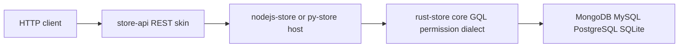

# store-api

**A REST surface generated from a schema — no controllers, no second query language, no permission logic. Every route, filter, error and denial is a direct translation of the store's own GQL and RBAC semantics.**


- `store-api-node` — Fastify plugin, npm, version 0.6.3.
- `store-api-py` — FastAPI factory, PyPI, version 0.6.3.
- `spec/` — six documents that decide routing, params, errors, context and headers once, for both runtimes.

> 中文: [README.md](./README.md)

## The thirty-seven routes nobody wanted to write

At a Tuesday standup, a team counts what a REST front end needs. Seven schemas — user, order, invoice and four more — five verbs each is thirty-five handlers. Two byte routes for attachments push the count to thirty-seven.

Then the drift starts. The Node service pluralizes `/users`; the Python service does not. One handler answers a missing record with `404`; another answers it with `200` and `null`. Filters are `?age_gte=18` on one endpoint and `?min_age=18` next door. A permission denial arrives as `403 {"error":"forbidden"}` here and `403 {"message":"no"}` there. None of this is business logic. All of it is translation, copied thirty-seven times — and every copy is a place where two services can give different answers to the same question.

store-api deletes those copies. You register a schema with the store; the adapter mounts one route family for it. The filter grammar is GQL, the permission decision is RBAC, and the HTTP layer only carries status codes and bytes between them.

## What it actually does

At mount time the adapter reads `store.list()` and generates one route family per resource, using the schema name verbatim. Five JSON routes plus two byte routes:

| Method | Path | Store call | Success |
|---|---|---|---|
| GET | `/{prefix}/{resource}` | `query(gql, params)` | `200 {"data": [...]}` |
| GET | `/{prefix}/{resource}/{id}` | `queryOne(gql, params)` | `200 {"data": {...}}` |
| POST | `/{prefix}/{resource}` | `insert(name, body)` | `201 {"data": ...}` |
| PATCH | `/{prefix}/{resource}/{id}` | `update(name, cond, body)` | `200 {"data": ...}` |
| DELETE | `/{prefix}/{resource}/{id}` | `remove(name, cond)` | `200 {"data": ...}` |
| GET | `/{prefix}/{resource}/{id}/file` | `queryOne`, then `fileResolver` | `200` byte stream, not a JSON envelope |
| POST | `/{prefix}/{resource}/{id}/file` | `queryOne`, `uploadResolver`, `update` | `200 {"data": ...}` |

The prefix belongs to the host framework — `app.register(..., { prefix: '/api' })` on Fastify, `create_app(store, prefix='/api')` on FastAPI — not to an adapter option.

Who owns what:

| Concern | Owner |
|---|---|
| Route shape and status codes | store-api |
| Filter, sort, page, relation, aggregate | GQL, passed through |
| Field types, defaults, validation, computed columns | the schema |
| Identity | your `contextProvider` |
| Permission decision | store RBAC |
| File bytes and MIME | your resolvers |

There is no `PUT`: the store's `update` is partial, and full-replacement semantics do not exist upstream. There are no pluralized routes and no relation sub-routes. The one exception is `/{resource}/{id}/file`.

## How the translation works

### Schema in, routes out

`store.list()` is filtered before routes are generated: a name ending in `Deleted` gets no route when its base name is also registered, because the store keeps an archive mirror for every schema. Pass `resources: [...]` to pin the exposed surface explicitly.

Projections are generated, never omitted. GQL's contract is that a query without a projection returns only `_id` — not "all fields" — so the adapter reads the schema's `fields` keys and builds `user { name, age }` for single-record reads and for lists without `q`. A schema that declares no fields degrades to `_id` only; the consequence is visible in the response rather than hidden by a fallback.

`{id}` is bound as an equality condition on the primary-key field — `idField`, `_id` by default:

```text
GET /api/user/abc
  ⇒ store.queryOne('user($condition: @c0) { name, age }', { c0: { _id: 'abc' } })
```

### `q` is GQL, `p.*` is the binding

The query string is not a mini-language. `q` is the GQL fragment after the resource head, appended verbatim; the adapter prepends the resource name. Every parameter is passed as `p.<name>`:

```text
GET /api/user?q=($condition: @c0, $limit: @l) { name, age }&p.c0={"age":{"$gte":18}}&p.l=10
  ⇒ store.query('user($condition: @c0, $limit: @l) { name, age }',
                { c0: { age: { $gte: 18 } }, l: 10 })
```

Values arrive as strings and are coerced once, in a fixed order: `true`/`false` to booleans, `null` to null, integers, floats, then JSON for objects and arrays; anything else stays a string. A repeated `p.tag=a&p.tag=b` binds an array. Literals are rejected: `$limit: 10` must be written `$limit: @l`, because core answers `ERR_GQL_PARSE:` and the skin returns `400 GQL_PARSE`.

`field=images.full` is the only other query parameter, and it affects the byte routes only.

### Three error states, none of them invented

The skin refuses to flatten failures into one shape.

1. **A miss.** A single-record read that finds nothing is `404` with code `NOT_FOUND`. When the store itself raises `ERR_NOT_FOUND`, that machine code is not swallowed or renamed — it surfaces as `not_found`.
2. **A denial.** `403`, carrying the store's own code and message — `permission_denied`, `RBAC`, or `no_context` when `requireContext` is on and no context was injected. There is no uniform "forbidden" payload, and no classification by matching message text.
3. **Everything else.** `500`, with the store's raw code and message passed through.

Two adjacent cases are kept separate on purpose. A `contextProvider` that throws a non-permission error is `401 CONTEXT_ERROR` — the only 401 the skin produces. A missing resolver is `501 FILE_NOT_CONFIGURED` or `501 UPLOAD_NOT_CONFIGURED`, checked before any store call, so "not wired up" is always distinguishable from "record missing".

Every error body is `{"error": {"code": ..., "message": ...}}`. A message that does not exist becomes `null`, never an invented string. A 2xx response never carries an `error` field.

### Identity in, permission out — and two honest headers

The adapter parses no headers. `Authorization`, `Cookie` and `API-Key` are untouched. Identity comes from one hook:

```javascript
app.register(storeApiPlugin, {
  store,
  prefix: '/api',
  contextProvider: async (req) => verifyJwt(req.headers.authorization),
});
```

The returned value is injected through `store.setContext(ctx)` before the handler runs. `null` is injected as an explicit clear, so one request's identity cannot leak into the next. `requireContext` remains the store's own switch: if it is on and no provider is configured, assembly fails immediately with `ERR_SECURE_CONFIG` instead of starting a service that would fail every request.

Two response headers are worth knowing. `x-cache` is an annotation, never an implementation: `BYPASS` in this version, attached to every response including errors, sourced from `store.cacheStatus()` when the host provides one. Downloads set `content-type` and `content-disposition` from the `fileResolver` return value, defaulting to `application/octet-stream` and `attachment; filename="file"`.

## Run it

```bash
npm install store-api-node nodejs-store
pip install store-api-py storepy uvicorn
```

Node, against a real MongoDB-backed store:

```javascript
const { MongoClient } = require('mongodb');
const { init, store } = require('nodejs-store');
const Fastify = require('fastify');
const { storeApiPlugin } = require('store-api-node');

async function main() {
  const client = new MongoClient('mongodb://localhost:27017');
  await client.connect();
  await init(client.db('app'));

  store.register({
    name: 'user',
    fields: { name: { type: 'string' }, age: { type: 'number' } },
  });

  const app = Fastify();
  await app.register(storeApiPlugin, { store, prefix: '/api' });
  await app.listen({ port: 3000 });
}

main();
```

Python, same schema and same routes:

```python
import asyncio
import uvicorn
from pymongo import AsyncMongoClient
from py_store import init, store
from store_api_py import create_app

async def main():
    client = AsyncMongoClient('mongodb://localhost:27017')
    await init(client['app'])
    store.register({
        'name': 'user',
        'fields': {'name': {'type': 'string'}, 'age': {'type': 'number'}},
    })
    app = create_app(store, prefix='/api')
    await uvicorn.Server(uvicorn.Config(app, port=3000)).serve()

asyncio.run(main())
```

Five CRUD routes now exist under `/api/user`, plus the two byte routes. A filtered list, using the grammar the store already understands:

```bash
curl -s -G 'http://localhost:3000/api/user' \
  --data-urlencode 'q=($condition: @c0) { name, age }' \
  --data-urlencode 'p.c0={"age":{"$gte":18}}'
# {"data":[{"_id":"...","name":"alice","age":30}]}
```

The same request set is exercised in `node/test/smoke.test.js` and `py/tests/test_smoke.py`; the status-code matrix is mirrored in `node/test/error-matrix.test.js` and `py/tests/test_error_matrix.py`.

## Boundaries: when not to use it

- **You need authentication or authorisation policy.** The skin parses no auth headers, has no sessions, no rate limiting and no cache. It gives you one hook and forwards the store's decision.
- **You need business validation, defaults or computed columns.** Those belong to the schema, in the store. The adapter passes the JSON body through untouched.
- **You need `PUT`, batch endpoints, pluralized routes or relation sub-resources.** None of them exist upstream in a form this layer can map without inventing semantics. Related data is fetched through GQL relation expansion.
- **You need a response envelope with `total`, `page` or `offset`.** A count is a separate GQL aggregate query; the skin adds no paging metadata.
- **You are not on a `*-store` host.** There is nothing to adapt.

## Where it sits in the family

store-api is the outermost layer of common-store: one of several protocol skins over the same store semantics. Its siblings are [store-graphql](https://github.com/coenddt/store-graphql), [store-grpc](https://github.com/coenddt/store-grpc) and [store-mcp](https://github.com/coenddt/store-mcp); [store-gateway](https://github.com/coenddt/store-gateway) assembles several skins in one process. Below it sit the hosts [nodejs-store](https://github.com/coenddt/nodejs-store) and [py-store](https://github.com/coenddt/py-store), and beneath both, [rust-store](https://github.com/coenddt/rust-store) — parser, permission pipeline and SQL dialects. Unpublished Go and Rust adapters live under `go/` and `rust/` in this repository.

The rule that keeps the family honest: a change lands in `spec/` first, then in the runtimes, then as a conformance case. Spec, code and cases that disagree are a defect.

## One diagram



REST in, REST out. The meaning in the middle is never store-api's own.
