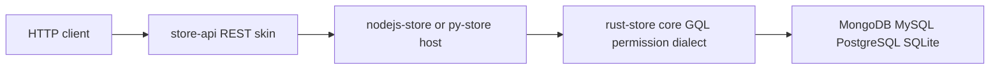

# store-api

**由 schema 生成的 REST 面 —— 没有 controller，没有第二套查询语言，没有权限逻辑。每条路由、每个筛选、每个错误与拒绝，都是 store 自身 GQL 与 RBAC 语义的直接翻译。**


- `store-api-node` —— Fastify 插件，npm，版本 0.6.3。
- `store-api-py` —— FastAPI 工厂，PyPI，版本 0.6.3。
- `spec/` —— 六份文档，一次决定路由、参数、错误、上下文与响应头，两个运行时共用。

> 英文主 README：[README.md](./README.md)

## 没人想写的那三十七条路由

周二站会，团队数了一遍 REST 前端要多少东西。七个 schema —— user、order、invoice 再加四个 —— 每个五个动词，就是三十五个 handler。两条附件字节路由把数字推到三十七。

然后漂移开始。Node 服务把路由复数化成 `/users`，Python 服务没有。一个 handler 用 `404` 回答记录不存在，隔壁用 `200` 加 `null`。筛选在这个端点是 `?age_gte=18`，在隔壁是 `?min_age=18`。权限拒绝在这里是 `403 {"error":"forbidden"}`，在那里是 `403 {"message":"no"}`。

这些都不是业务逻辑，全是翻译，被抄了三十七遍 —— 而每一份副本，都是两个服务可能对同一个问题给出不同答案的地方。

store-api 删掉这些副本。你向 store 注册 schema，适配器为它挂载一族路由。筛选语法是 GQL，权限判定是 RBAC，HTTP 层只在两者之间搬运状态码与字节。

## 它实际做什么

挂载时，适配器读取 `store.list()`，按资源生成一族路由，路由段用 schema 名**原样**。五条 JSON 路由，加两条字节路由：

| 方法 | 路径 | 调用 store | 成功 |
|---|---|---|---|
| GET | `/{prefix}/{resource}` | `query(gql, params)` | `200 {"data": [...]}` |
| GET | `/{prefix}/{resource}/{id}` | `queryOne(gql, params)` | `200 {"data": {...}}` |
| POST | `/{prefix}/{resource}` | `insert(name, body)` | `201 {"data": ...}` |
| PATCH | `/{prefix}/{resource}/{id}` | `update(name, cond, body)` | `200 {"data": ...}` |
| DELETE | `/{prefix}/{resource}/{id}` | `remove(name, cond)` | `200 {"data": ...}` |
| GET | `/{prefix}/{resource}/{id}/file` | `queryOne`，再 `fileResolver` | `200` 字节流，不是 JSON 壳 |
| POST | `/{prefix}/{resource}/{id}/file` | `queryOne`、`uploadResolver`、`update` | `200 {"data": ...}` |

前缀属于宿主框架 —— Fastify 上是 `app.register(..., { prefix: '/api' })`，FastAPI 上是 `create_app(store, prefix='/api')` —— 不是适配器选项。

谁拥有什么：

| 关注点 | 归属 |
|---|---|
| 路由形态与状态码 | store-api |
| 筛选、排序、分页、关系、聚合 | GQL，透传 |
| 字段类型、默认值、校验、计算列 | schema |
| 身份 | 你的 `contextProvider` |
| 权限判定 | store 的 RBAC |
| 文件字节与 MIME | 你的 resolver |

没有 `PUT`：store 的 `update` 是部分更新，全量替换语义在上游不存在。没有复数化路由，没有关系子路由。唯一例外是 `/{resource}/{id}/file`。

## 翻译是怎么发生的

### schema 进，路由出

生成路由前先过滤 `store.list()`：名字以 `Deleted` 结尾、且其基名也已注册的，不生成路由 —— store 为每个 schema 保留一份归档镜像。传 `resources: [...]` 可以显式钉住暴露面。

投影是生成的，从不省略。GQL 的契约是：没有投影段的查询只返回 `_id` —— 不是「全字段」。所以适配器读 schema 的 `fields` 键，为单条读取和无 `q` 的列表拼出 `user { name, age }`。没声明字段的 schema 退化为只返回 `_id`；这个后果在响应里看得见，而不是被兜底藏起来。

`{id}` 被绑成主键字段上的等值条件 —— 字段名取 `idField`，默认 `_id`：

```text
GET /api/user/abc
  ⇒ store.queryOne('user($condition: @c0) { name, age }', { c0: { _id: 'abc' } })
```

### `q` 是 GQL，`p.*` 是绑定

查询串不是迷你语言。`q` 是资源头之后的 GQL 片段，原样拼接；适配器在前面补上资源名。每个参数都走 `p.<name>`：

```text
GET /api/user?q=($condition: @c0, $limit: @l) { name, age }&p.c0={"age":{"$gte":18}}&p.l=10
  ⇒ store.query('user($condition: @c0, $limit: @l) { name, age }',
                { c0: { age: { $gte: 18 } }, l: 10 })
```

值以字符串到达，按固定顺序只转换一次：`true`/`false` 变布尔，`null` 变 null，整数、浮点，然后是对象与数组走 JSON；其余保持字符串。重复的 `p.tag=a&p.tag=b` 绑成数组。字面量被拒绝：`$limit: 10` 必须写成 `$limit: @l`，因为 core 会回 `ERR_GQL_PARSE:`，皮返回 `400 GQL_PARSE`。

`field=images.full` 是另一个查询参数，只影响字节路由。

### 三种错误状态，一个都不是发明的

皮拒绝把失败压成同一种形状。

1. **没找到。** 单条读取查不到是 `404`，code `NOT_FOUND`。store 自己抛 `ERR_NOT_FOUND` 时，机器码不被吞掉也不改名 —— 以 `not_found` 浮出。
2. **被拒绝。** `403`，携带 store 自己的 code 与 message —— `permission_denied`、`RBAC`，或 `requireContext` 打开且没有上下文时的 `no_context`。没有统一的「forbidden」载荷，也不靠匹配 message 文本做分类。
3. **其余一切。** `500`，透传 store 的原始 code 与 message。

两个相邻情形被刻意分开。`contextProvider` 抛出非权限错误是 `401 CONTEXT_ERROR` —— 皮产生的唯一 401。缺少 resolver 是 `501 FILE_NOT_CONFIGURED` 或 `501 UPLOAD_NOT_CONFIGURED`，在任何 store 调用之前检查，所以「没接线」永远能与「记录不存在」区分。

每个错误体都是 `{"error": {"code": ..., "message": ...}}`。取不到的 message 置 `null`，绝不编造字符串。2xx 响应永不携带 `error` 字段。

### 身份进，权限出 —— 两个诚实的头

适配器不解析任何头。`Authorization`、`Cookie`、`API-Key` 一概不碰。身份来自一个钩子：

```javascript
app.register(storeApiPlugin, {
  store,
  prefix: '/api',
  contextProvider: async (req) => verifyJwt(req.headers.authorization),
});
```

返回值在 handler 执行前经 `store.setContext(ctx)` 注入。`null` 作为显式清除注入，所以一次请求的身份不会泄漏到下一次。`requireContext` 仍是 store 自己的开关：如果开着却没配 provider，装配期立即以 `ERR_SECURE_CONFIG` 失败，而不是启动一个每个请求都会失败的服务。

两个响应头值得知道。`x-cache` 是注记，永不实现：本版恒为 `BYPASS`，挂在每个响应上（含错误响应），来源是宿主提供的 `store.cacheStatus()`。下载从 `fileResolver` 的返回值设置 `content-type` 与 `content-disposition`，默认 `application/octet-stream` 与 `attachment; filename="file"`。

## 跑起来

```bash
npm install store-api-node nodejs-store
pip install store-api-py storepy uvicorn
```

Node，接一个真实的 MongoDB 后端：

```javascript
const { MongoClient } = require('mongodb');
const { init, store } = require('nodejs-store');
const Fastify = require('fastify');
const { storeApiPlugin } = require('store-api-node');

async function main() {
  const client = new MongoClient('mongodb://localhost:27017');
  await client.connect();
  await init(client.db('app'));

  store.register({
    name: 'user',
    fields: { name: { type: 'string' }, age: { type: 'number' } },
  });

  const app = Fastify();
  await app.register(storeApiPlugin, { store, prefix: '/api' });
  await app.listen({ port: 3000 });
}

main();
```

Python，同样的 schema、同样的路由：

```python
import asyncio
import uvicorn
from pymongo import AsyncMongoClient
from py_store import init, store
from store_api_py import create_app

async def main():
    client = AsyncMongoClient('mongodb://localhost:27017')
    await init(client['app'])
    store.register({
        'name': 'user',
        'fields': {'name': {'type': 'string'}, 'age': {'type': 'number'}},
    })
    app = create_app(store, prefix='/api')
    await uvicorn.Server(uvicorn.Config(app, port=3000)).serve()

asyncio.run(main())
```

`/api/user` 之下现在有五条 CRUD 路由，外加两条字节路由。一次带筛选的列表，用的就是 store 已经懂的语法：

```bash
curl -s -G 'http://localhost:3000/api/user' \
  --data-urlencode 'q=($condition: @c0) { name, age }' \
  --data-urlencode 'p.c0={"age":{"$gte":18}}'
# {"data":[{"_id":"...","name":"alice","age":30}]}
```

同一组请求在 `node/test/smoke.test.js` 与 `py/tests/test_smoke.py` 里跑；状态码矩阵在 `node/test/error-matrix.test.js` 与 `py/tests/test_error_matrix.py` 里对齐。

## 边界：什么时候不要用

- **你需要认证或授权策略。** 皮不解析认证头，没有会话、限流、缓存。它只给一个钩子，转发 store 的判决。
- **你需要业务校验、默认值、计算列。** 那些属于 store 里的 schema。适配器原样透传 JSON 体。
- **你需要 `PUT`、批量端点、复数化路由或关系子资源。** 上游没有一种形态能让这一层映射而不发明语义。关联数据走 GQL 关系展开。
- **你需要带 `total`、`page`、`offset` 的响应壳。** 计数是另一次 GQL 聚合查询；皮不添加分页元数据。
- **你不在某个 `*-store` 宿主上。** 没有可适配的对象。

## 它在家族里的位置

store-api 是 common-store 的最外层：同一套 store 语义之上的若干协议皮之一。兄弟是 [store-graphql](https://github.com/coenddt/store-graphql)、[store-grpc](https://github.com/coenddt/store-grpc) 与 [store-mcp](https://github.com/coenddt/store-mcp)；[store-gateway](https://github.com/coenddt/store-gateway) 在一个进程里组装多张皮。下面是宿主 [nodejs-store](https://github.com/coenddt/nodejs-store) 与 [py-store](https://github.com/coenddt/py-store)，再往下是 [rust-store](https://github.com/coenddt/rust-store) —— 解析器、权限管道与 SQL 方言。未发布的 Go 与 Rust 适配器放在本仓库的 `go/` 与 `rust/`。

让家族保持诚实的规则：变更先落 `spec/`，再落运行时，最后成为 conformance 用例。规范、代码、用例三者不一致，就是缺陷。

## 一图看懂



REST 进，REST 出。中间那层语义，从来不是 store-api 自己的。
